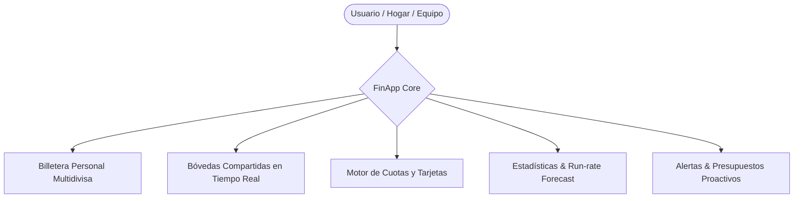
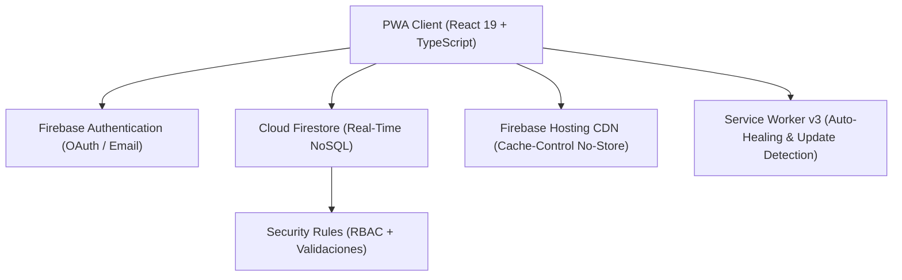
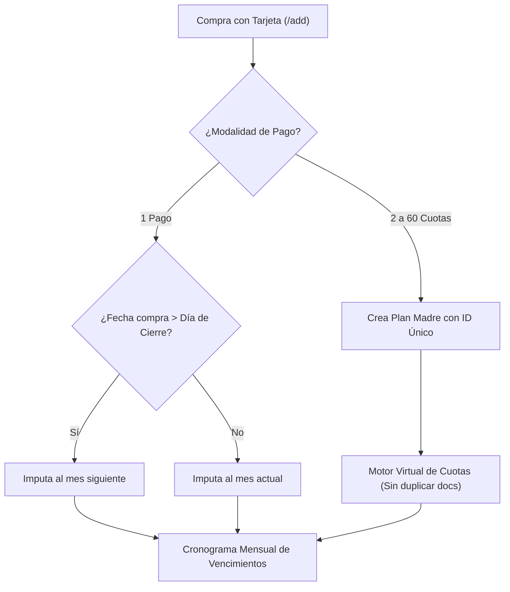

# Documentación Funcional Completa: FinApp 📘

> **Sistema de Inteligencia Financiera Personal, Bóvedas Compartidas y Control de Crédito en Tiempo Real**  
> **Versión Oficial:** `v2.16.0` (Producción)  
> **Última Actualización:** Noviembre 2026  
> **Estado del Entorno:** Operativo en Producción (`main`) y canal QA (`dev`)  
> **URL Producción:** [https://gen-lang-client-0187524364.web.app](https://gen-lang-client-0187524364.web.app)

---

## 📑 Tabla de Contenidos

1. [Visión General, Propuesta de Valor y Pitch](#1-visión-general-propuesta-de-valor-y-pitch)
2. [Arquitectura Tecnológica y Modelo de Datos](#2-arquitectura-tecnológica-y-modelo-de-datos)
3. [Guía Funcional Detallada Módulo por Módulo](#3-guía-funcional-detallada-módulo-por-módulo)
   - [Módulo 1: Dashboard Ejecutivo (Inicio / Home)](#módulo-1-dashboard-ejecutivo-inicio--home)
   - [Módulo 2: Tarjetas de Crédito y Planes de Cuotas](#módulo-2-tarjetas-de-crédito-y-planes-de-cuotas)
   - [Módulo 3: Bóvedas Compartidas y Finanzas Colaborativas](#módulo-3-bóvedas-compartidas-y-finanzas-colaborativas)
   - [Módulo 4: Registro, Edición y Clasificación de Movimientos](#módulo-4-registro-edición-y-clasificación-de-movimientos)
   - [Módulo 5: Atajos Rápidos de Carga (Shortcuts con Keypad Táctil)](#módulo-5-atajos-rápidos-de-carga-shortcuts-con-keypad-táctil)
   - [Módulo 6: Historial de Transacciones, Búsqueda y Filtros Combinables](#módulo-6-historial-de-transacciones-búsqueda-y-filtros-combinables)
   - [Módulo 7: Presupuestos Mensuales y Semáforo de Control](#módulo-7-presupuestos-mensuales-y-semáforo-de-control)
   - [Módulo 8: Centro de Estadísticas e Inteligencia Financiera (v2.16.0)](#módulo-8-centro-de-estadísticas-e-inteligencia-financiera-v2160)
   - [Módulo 9: Informes Ejecutivos y Exportación (PDF, CSV, WhatsApp)](#módulo-9-informes-ejecutivos-y-exportación-pdf-csv-whatsapp)
   - [Módulo 10: Centro de Notificaciones y Mantenimiento Autónomo](#módulo-10-centro-de-notificaciones-y-mantenimiento-autónomo)
   - [Módulo 11: Perfil de Usuario, Temas y Seguridad](#módulo-11-perfil-de-usuario-temas-y-seguridad)
   - [Módulo 12: Sistema de Versionado, Cache-Busting y PWA](#módulo-12-sistema-de-versionado-cache-busting-y-pwa)
4. [Casos Prácticos y Flujos de Uso de la Vida Real](#4-casos-prácticos-y-flujos-de-uso-de-la-vida-real)
5. [Seguridad, Permisos y Reglas de Firestore (RBAC)](#5-seguridad-permisos-y-reglas-de-firestore-rbac)
6. [Guía Rápida para Presentaciones y Demostraciones (Pitch Guide)](#6-guía-rápida-para-presentaciones-y-demostraciones-pitch-guide)

---

## 1. Visión General, Propuesta de Valor y Pitch

### ¿Qué es FinApp?
**FinApp** es una Progressive Web App (PWA) de inteligencia financiera diseñada para resolver la fricción cotidiana de administrar el dinero, tanto a nivel **individual** como en **equipo** (parejas, familias, compañeros de vivienda, viajes grupales o emprendimientos).

A diferencia de las aplicaciones bancarias tradicionales (que solo muestran saldos aislados de sus propias cuentas) o de las hojas de cálculo manuales (que son lentas y se desactualizan), FinApp combina:
1. **Velocidad extrema de registro:** Carga de gastos habituales en menos de 3 segundos desde el smartphone.
2. **Bóvedas compartidas en tiempo real:** Gestión colaborativa sin planillas externas ni cruces manuales de gastos.
3. **Control milimétrico del endeudamiento en cuotas:** Proyección automática mes a mes de tarjetas de crédito sin duplicación de registros.
4. **Inteligencia y métricas accionables:** Diagnóstico de salud financiera basado en la regla 50/30/20, proyección de cierre de mes (run-rate), tasa de ahorro real y auditoría por categoría en un toque.



### 🌟 Pilares Diferenciales (Ideal para Pitch y Presentaciones):
* **Bóvedas Multidivisa Colaborativas:** Soporte en tiempo real para ARS, USD, EUR, BRL, CLP y UYU con balances diferenciados y miembros con roles controlados.
* **Proyección Virtual de Cuotas:** El usuario registra la compra financiada una sola vez y el motor financiero expande los resúmenes y compromisos mes a mes automáticamente.
* **Clasificación Financiera Estructural:** Diferenciación nativa entre **Gastos Fijos** (costo de vida indispensable: alquiler, servicios, salud) y **Gastos Variables** (consumo discrecional y ocio) para calcular el verdadero margen de resiliencia financiera.
* **Modo Privacidad / Incógnito Instantáneo:** Enmascara todos los saldos en pantalla con un solo toque (`••••••`) para operar con tranquilidad en transporte público o lugares concurridos.
* **PWA Offline-Ready de Alta Resiliencia:** Instalable en iOS y Android como app nativa, con auto-sanación ante cachés corruptas y detección de actualizaciones en segundo plano.

---

## 2. Arquitectura Tecnológica y Modelo de Datos

### Stack Tecnológico:
- **Frontend Core:** React 19, TypeScript, Vite 6, Tailwind CSS v4, Motion (animaciones fluidas a 60fps).
- **Iconografía & Gráficos:** Lucide React, Recharts (gráficos vectoriales interactivos adaptados a temas claro/oscuro).
- **Backend Serverless:** Google Cloud Firestore (Base de datos NoSQL reactiva en tiempo real), Firebase Authentication (Google OAuth + Email/Password).
- **Hosting & CDN:** Firebase Hosting con políticas estrictas de Cache-Busting y Service Worker v3.
- **Motores de Reportes:** jsPDF, jsPDF-AutoTable (generación de PDFs ejecutivos en cliente) y motor de formateo CSV.



### Modelo de Datos (Colecciones Firestore):

| Colección | Descripción | Campos Clave |
| :--- | :--- | :--- |
| **`users`** | Perfil y preferencias del usuario. | `uid`, `name`, `email`, `currency`, `themePreference`, `personalCardColor`, `personalShowInHome`, `personalHomeOrder`. |
| **`projects`** | Bóvedas compartidas de gasto común. | `id`, `name`, `currency`, `ownerId`, `memberIds[]`, `pendingEmails[]`, `status` ('active'\|'inactive'), `cardColor`, `homeOrder`. |
| **`categories`** | Categorías de gasto e ingreso. | `id`, `name`, `icon`, `color`, `type` ('expense'\|'income'), `ownerId`, `scope` ('system'\|'project'\|'personal'). |
| **`transactions`** | Movimientos financieros y planes madre. | `id`, `amount`, `type`, `description`, `date`, `categoryId`, `projectId`, `authorId`, `paymentMethod`, `classification` ('fixed'\|'variable'), `cardId`, `cardName`, `isInstallment`, `installmentNumber`, `totalInstallments`, `installmentPlanId`, `firstDueDate`. |
| **`cards`** | Tarjetas de crédito configuradas. | `id`, `userId`, `name`, `bank`, `lastFourDigits`, `cardColor`, `closingDay` (día de corte), `dueDay` (día de pago). |
| **`budgets`** | Techos de gasto mensuales. | `id`, `categoryId`, `amount`, `month` ('YYYY-MM'), `projectId`. |
| **`shortcuts`** | Atajos rápidos preconfigurados. | `id`, `userId`, `name`, `amount`, `categoryId`, `projectId`, `paymentMethod`, `icon`, `color`. |
| **`notifications`**| Avisos, invitaciones y alertas. | `id`, `userId`, `title`, `message`, `type`, `read`, `createdAt`. |

---

## 3. Guía Funcional Detallada Módulo por Módulo

---

### Módulo 1: Dashboard Ejecutivo (Inicio / Home)

El **Home** es el centro de control financiero. Brinda un panorama completo de la salud económica en menos de 5 segundos.

```
+-------------------------------------------------------------+
| [FinApp Logo]                 [Notificaciones 🔔] [Ojo 👁️]  |
| <                    Noviembre 2026                       > |
+-------------------------------------------------------------+
| [Tarjetas de Balance Deslizables (Personal + Bóvedas)]      |
|  - Saldo Anterior  |  + Ingresos  |  - Egresos  |  = Saldo  |
+-------------------------------------------------------------+
| [Compromisos y Cuotas]                                      |
|  💳 3 Tarjetas Activas  | Vencen este mes: $446.666,67      |
|  23 Planes activos      | Total adeudado: $1.820.000,00     |
+-------------------------------------------------------------+
| [Carrusel de Atajos Rápidos ⚡]                              |
|  [☕ Café]   [🛒 Super]   [⛽ Nafta]   [🍽️ Almuerzo]         |
+-------------------------------------------------------------+
| [Actividad Reciente (Últimos 3)]             [Ver Todo ->]  |
+-------------------------------------------------------------+
```

#### Funcionalidades Clave:
1. **Navegador Temporal (`<` y `>`):** Permite desplazarse hacia meses pasados para auditar rendimientos o hacia meses futuros para prever vencimientos de cuotas.
2. **Modo Incógnito (Ojo 👁️):** Enmascara al instante todos los montos con `••••••`. Se sincroniza y persiste en las preferencias locales del navegador.
3. **Tarjetas de Balance Deslizables:**
   - Carrusel con la billetera Personal y cada una de las Bóvedas activas.
   - Detalle desglosado: **Saldo Inicial Acumulado**, **Ingresos del Mes (+)**, **Egresos del Mes (-)** y **Resultado Neto**.
   - Colores y gradientes personalizables por cada usuario.
4. **Widget de Compromisos y Cuotas:**
   - Total exacto a pagar en el resumen del mes seleccionado.
   - Cantidad de tarjetas activas con vencimientos en ese período.
   - Deuda total proyectada a futuro (suma de todas las cuotas pendientes de meses venideros).
5. **Carrusel de Atajos Rápidos (`⚡`):** Acceso inmediato a gastos frecuentes con un toque.
6. **Actividad Reciente:** Visualización limpia de los últimos 3 movimientos con acceso directo al historial completo.

---

### Módulo 2: Tarjetas de Crédito y Planes de Cuotas

Ubicación: Menú lateral o mediante la tarjeta de compromisos en el Home (`/credit-cards`).



#### Capacidades Avanzadas:
1. **Configuración de Tarjetas (`/cards`):**
   - Nombre de fantasía, entidad emisora y últimos 4 dígitos.
   - Color del plástico digital.
   - **Día de Cierre (Corte de Resumen):** Determina qué consumos ingresan en el período.
   - **Día de Vencimiento:** Día límite de pago del resumen bancario.
2. **Lógica de Imputación Inteligente:**
   - Si la compra se efectúa luego del día de cierre, FinApp computa la primera cuota en el mes posterior.
   - Permite al usuario forzar la imputación en el mes vigente mediante interruptor si ya canceló el resumen o prefiere registrar el gasto de inmediato.
3. **Motor de Cuotas Virtuales (`installmentUtils.ts`):**
   - Elimina la duplicación de documentos en Firestore: se guarda un solo registro madre con `firstDueDate`, `totalInstallments` y `originalPurchaseAmount`.
   - La aplicación proyecta en memoria las cuotas `1/12`, `2/12`... en cada mes correspondiente.
4. **Cronograma Mensual y Eliminación con Doble Opción:**
   - Pestañas mensuales con el monto consolidado a pagar por cada tarjeta.
   - Al eliminar un registro con cuotas, el sistema consulta:
     - *¿Eliminar solo esta cuota puntual?* (ajuste de resumen).
     - *¿Eliminar el plan de cuotas completo?* (cancelación total o anulación de compra).

---

### Módulo 3: Bóvedas Compartidas y Finanzas Colaborativas

Ubicación: `/shared` y `/project/:id`.

Diseñado para terminar con los problemas de "quién le debe a quién" en parejas, familias, departamentos compartidos o proyectos de trabajo.

```
+-------------------------------------------------------------+
| Bóveda: "Departamento 3B"                       [Ajustes ⚙️] |
| Divisa: ARS ($) • 2 Miembros                                |
+-------------------------------------------------------------+
| Saldo del Mes: $ 185.400,00                                 |
+-------------------------------------------------------------+
| Aportes de Miembros este mes:                               |
|  - Alejandro R. : $ 115.000,00 (62%) [=================   ] |
|  - Valentina M. : $  70.400,00 (38%) [==========        ] |
+-------------------------------------------------------------+
```

#### Funcionalidades Clave:
1. **Creación Multidivisa:** Cada bóveda define su propia moneda (ARS, USD, EUR, etc.), independiente de la moneda principal de los integrantes.
2. **Sistema de Invitación por Email:**
   - **Destinatario ya registrado:** Ingresa de inmediato al proyecto con notificación automática.
   - **Destinatario no registrado:** Queda en estado *Invitación Pendiente*. Cuando la persona crea su cuenta con ese correo, el sistema reclama la invitación y la suma automáticamente sin pasos extra.
3. **Trazabilidad Total:** Cada movimiento dentro de la bóveda exhibe el autor, medio de pago y categoría elegida.
4. **Configuración de Visibilidad Personal:** Cada miembro elige si la bóveda se visualiza en su Home y en qué orden del carrusel.

---

### Módulo 4: Registro, Edición y Clasificación de Movimientos

Ubicación: Botón central flotante `+` o ruta `/add`.

Diseñado con ergonomía táctil: accesible con una sola mano, sin desbordes de pantalla ni solapamiento con el teclado móvil.

```
+-------------------------------------------------------------+
| [ <- Volver ]              Registrar Movimiento             |
+-------------------------------------------------------------+
|  [ Gasto (Egreso) ]              [ Ingreso (+) ]            |
+-------------------------------------------------------------+
|  Monto: $ [ 32.500,00                                     ] |
|  Concepto: [ Combustible YPF                              ] |
|  Destino:  (•) Personal     ( ) Casa / Hogar                |
|  Categoría: [ ⛽ Transporte y Auto                         ] |
|  Medio:     [ 💳 Tarjeta de Crédito                       ] |
|  Tarjeta:   [ Visa Signature (x1042)                      ] |
|  Cuotas:    [ 1 pago                                      ] |
|  Estructura: (•) Fijo / Indispensable  ( ) Variable / Ocio  |
+-------------------------------------------------------------+
| [ Guardar Registro ]                                        |
+-------------------------------------------------------------+
```

#### Atributos del Movimiento:
* **Tipo:** Gasto vs Ingreso.
* **Monto:** Teclado numérico nativo optimizado con formateador de moneda.
* **Destino:** Billetera Personal vs Bóveda Compartida.
* **Medio de Pago:** Efectivo, Débito, Transferencia Bancaria, Tarjeta de Crédito (despliega selector de plásticos y cuotas).
* **Clasificación Financiera Estructural:**
  - **Gasto Fijo:** Costos de vida indispensables (alquiler, expensas, luz, seguros, cuota de salud, educación).
  - **Gasto Variable:** Consumo discrecional (salidas, restaurantes, delivery, indumentaria, ocio).

---

### Módulo 5: Atajos Rápidos de Carga (Shortcuts con Keypad Táctil)

Ubicación: Carrusel del Home y `/shortcuts`.

Permite registrar consumos habituales de la vida diaria en menos de 3 segundos sin llenar formularios repetitivos.

#### Flujo Operativo:
1. El usuario toca el botón de atajo en el carrusel (ej: *Café matutino*).
2. Se despliega un **Keypad Modal Táctil** con dígitos de gran tamaño y botones de incremento rápido (+100, +500, +1.000).
3. Puede confirmar el monto estándar memorizado o ingresar uno nuevo con el pulgar.
4. Al pulsar **Confirmar**, la transacción se guarda con su categoría, medio de pago y destino preconfigurados, emitiendo una respuesta táctil (haptic feedback).

---

### Módulo 6: Historial de Transacciones, Búsqueda y Filtros Combinables

Ubicación: `/history`.

#### Potencia de Auditoría y Búsqueda:
* **Buscador Reactivo en Vivo:** Filtra al instante por descripción, comercio o palabras clave.
* **Filtros Multidimensionales:**
  - Por Tipo (Ingreso o Gasto).
  - Por Bóveda (Personal o Proyectos Compartidos).
  - Por Categoría específica.
  - Por Medio de Pago utilizado.
  - Por Clasificación (Fijo o Variable).
* **Edición y Eliminación Protegida:** Tocar cualquier registro abre el panel de edición o eliminación con confirmación modal.

---

### Módulo 7: Presupuestos Mensuales y Semáforo de Control

Ubicación: `/budgets`.

Permite establecer topes mensuales de gasto por categoría para evitar desvíos financieros.

#### Semáforo de Cumplimiento:
* 🟢 **0% a 79% (Saludable):** Barra verde esmeralda. Gasto bajo control.
* 🟡 **80% a 99% (Advertencia):** Barra ámbar/amarilla. Se emite una alerta preventiva en el Centro de Notificaciones.
* 🔴 **100%+ (Límite Superado):** Barra roja con animación de pulso y cuantificación exacta del exceso financiero.

---

### Módulo 8: Centro de Estadísticas e Inteligencia Financiera (v2.16.0)

Ubicación: `/stats`.

Totalmente rediseñado y potenciado en la versión **`v2.16.0`**. Resuelve la sobrecarga visual separando el análisis en 4 sub-pestañas temáticas con herramientas interactivas de diagnóstico.

```
+-------------------------------------------------------------+
| [<]                  NOVIEMBRE 2026                 [>] [Hoy]
+-------------------------------------------------------------+
| [ Resumen ]    [ Categorías ]   [ Estructura ]   [ Miembros ]
+-------------------------------------------------------------+
| [ 4 KPIs Principales con Comparativa MoM ]                  |
|  - Gastos: $ 620.000 (-8.2% vs mes ant.)                    |
|  - Ingresos: $ 950.000 (+5.0% vs mes ant.)                  |
|  - Balance: +$ 330.000 (Superávit neto)                     |
|  - Tasa de Ahorro: 34.7% (Óptimo >20%)                      |
+-------------------------------------------------------------+
| [ Proyección de Fin de Mes (Run-rate) ]                     |
|  Est. Cierre: $ 785.400,00 | Ritmo: $ 26.180/día            |
|  Día 10 de 30 (20 días restantes)                           |
+-------------------------------------------------------------+
| [ Inteligencia Financiera: Tarjetas con Consejos Clave ]    |
+-------------------------------------------------------------+
```

#### 1. Navegador Temporal Dinámico (`<`, `>` y chip "Hoy"):
- Permite desplazarse mes a mes (o semana/año según el filtro temporal).
- Recalcula instantáneamente todas las métricas, evolución y comparativas con el período anterior.
- Si el usuario se encuentra navegando en el pasado, aparece el chip **"Hoy"** para regresar al período en curso con un solo toque.

#### 2. Sub-pestañas de Navegación:
* **Pestaña `Resumen`:**
  - **4 KPIs Principales:** Gastos, Ingresos, Balance Neto y Tasa de Ahorro.
  - **Badges Comparativos MoM (Month-over-Month):** Indica la variación porcentual exacta respecto al mes anterior con semántica financiera (un aumento de gasto se muestra en rojo y una reducción en verde).
  - **Fórmula de Tasa de Ahorro:**
    $$\text{Tasa de Ahorro (\%)} = \frac{\text{Ingresos Totales} - \text{Gastos Totales}}{\text{Ingresos Totales}} \times 100$$
    *Clasificación:* Óptima ($\ge 20\%$), Moderada ($0\% - 20\%$) o Déficit ($< 0\%$).
  - **Tarjeta de Proyección de Cierre de Mes (Run-rate Forecast):** Proyecta a cuánto ascenderá el gasto a fin de mes si se mantiene el ritmo diario actual:
    $$\text{Gasto Proyectado} = \left(\frac{\text{Gastos Acumulados}}{\text{Días Transcurridos}}\right) \times \text{Días Totales del Mes}$$
  - **4 KPIs Secundarios:** Promedio diario de gasto, cantidad total de transacciones, día de mayor consumo (pico) y promedio gastado por ticket.
  - **Gráfico de Evolución Temporal:** Curva de área interactiva con tooltips adaptados a modo oscuro.
  - **Tarjetas de Inteligencia Financiera:** Tarjetas estructuradas con insignias temáticas (*Logro de Ahorro*, *Déficit Financiero*, *Concentración de Gasto*, *Límites Superados*, *Ritmo Diario*) que ofrecen consejos financieros accionables sin texto en formato markdown crudo.

* **Pestaña `Categorías`:**
  - **Gráfico de Dona de Distribución:** Desglose porcentual con categoría líder destacada en el centro.
  - **Lista Interactiva con Drill-down:** Cada fila muestra ícono, nombre, monto y porcentaje. Tocar cualquier categoría abre el **Modal de Drill-down**.
  - **Top 10 en Gráfico de Barras:** Ranking horizontal ordenado de mayor a menor gasto/ingreso con soporte de toque para abrir el detalle.
  - **Cumplimiento de Presupuestos:** Barras de avance respecto a los techos fijados para el mes seleccionado.
  - **Impacto sobre Ingresos:** Muestra qué porcentaje del ingreso total es consumido por cada categoría.

* **Pestaña `Estructura` (Diagnóstico de Resiliencia 50/30/20):**
  - Gráfico de torta comparativo: **Gastos Fijos** vs **Gastos Variables** vs **Sin Clasificar**.
  - Tarjetas de monto y participación porcentual de cada grupo.
  - **Indicador de Compromiso de Ingresos:** Evalúa qué porcentaje del ingreso neto está comprometido en costos fijos. Si supera el 50%, emite una advertencia de riesgo de liquidez.

* **Pestaña `Miembros`:**
  - Activa en proyectos compartidos. Compara los desembolsos e ingresos aportados por cada miembro del equipo con barras porcentuales proporcionales.

#### 3. Modal de Drill-Down por Categoría (Auditoría a Fondo):
Al tocar cualquier categoría en la lista o en el gráfico de barras, se abre un Bottom-Sheet que muestra:
- Nombre, ícono y color del rubro.
- Monto total y porcentaje relativo en el período.
- Cantidad de transacciones registradas.
- Listado cronológico de todos los movimientos individuales: fecha, descripción, medio de pago / tarjeta utilizada, número de cuota (ej: `Cuota 3/6`), autor y monto exacto.

---

### Módulo 9: Informes Ejecutivos y Exportación (PDF, CSV, WhatsApp)

Ubicación: `/reports`.

Permite generar documentación financiera formal lista para compartir con contadores, socios o parejas:
1. **Reporte PDF Profesional:** Membrete formal con logo FinApp, metadatos del usuario, balance consolidado y tabla formateada mediante `jspdf-autotable`.
2. **Exportación CSV estructurada:** Archivo delimitado por `;` con codificación UTF-8 listo para abrir directamente en Microsoft Excel o Google Sheets sin errores de caracteres.
3. **Compartir Resumen por WhatsApp:** Genera un mensaje formateado con emojis y saldos listo para enviar a cualquier contacto en 1 clic.

---

### Módulo 10: Centro de Notificaciones y Mantenimiento Autónomo

Ubicación: Ícono de campana 🔔 en la barra superior.

* **Alertas Generadas:**
  - Recordatorios de vencimiento de tarjetas de crédito (`checkCardDueAlerts`).
  - Avisos de reporte de cierre mensual (`checkMonthlyReportAlert`).
  - Alertas preventivas al alcanzar el 80% o 100% de un presupuesto.
  - Invitaciones a proyectos compartidos.
* **Auto-Mantenimiento:** El sistema purga de forma autónoma notificaciones con más de 7 días de antigüedad, asegurando una base de datos ligera y ágil.

---

### Módulo 11: Perfil de Usuario, Temas y Seguridad

Ubicación: `/settings`.

* **Identidad y Perfil:** Nombre, teléfono, profesión, biografía y selector de **12 avatares 3D vectoriales** prediseñados.
* **Modo Oscuro / Claro / Automático:** Soporte completo de paleta cromática de alto contraste para exteriores y modo noche para pantallas OLED.
* **Moneda Base:** ARS ($), USD (US$), EUR (€), BRL (R$), CLP ($), UYU ($).
* **Seguridad:** Gestión de sesión con Google OAuth o cambio seguro de contraseña mediante email con enlace encriptado.

---

### Módulo 12: Sistema de Versionado, Cache-Busting y PWA

Ubicación: Pie de página de Ajustes y Menú lateral.

* **Inyección de Versión en Build:** Vite compila automáticamente la versión (`v2.16.0`), commit hash de Git y fecha/hora exacta de compilación.
* **Badges de Entorno:** `[PROD]` en verde esmeralda, `[QA]` en ámbar y `[DEV]` en azul.
* **Verificación Silenciosa (`/version.json`):** Chequeo periódico cada 5 minutos o al cambiar de pestaña. Si hay una nueva versión en producción, despliega un aviso flotante: *"Nueva versión disponible"* con botón para actualizar sin interrumpir la tarea actual.
* **Auto-Sanación ante Caché Corrupta:** Si el navegador conserva versiones antiguas en el Service Worker, el sistema desregistra automáticamente los workers obsoletos y carga la última versión limpia.

---

## 4. Casos Prácticos y Flujos de Uso de la Vida Real

### Caso 1: Pareja que administra los gastos del hogar
1. **Creación de la Bóveda:** Uno de los miembros crea la bóveda *"Hogar & Casa"* en ARS e invita a su pareja por email.
2. **Carga en el Supermercado:** Al pagar la compra semanal, el integrante abre FinApp, presiona `+`, ingresa el monto, selecciona la categoría *Supermercado*, marca el destino *"Hogar & Casa"* y medio de pago *Débito*.
3. **Visibilidad Cruzada:** De forma instantánea, el otro integrante ve el movimiento en su teléfono.
4. **Cierre de Mes en Estadísticas:** En la pestaña `Miembros` de Estadísticas, la pareja revisa cuánto aportó cada uno para equilibrar las cuentas del mes sin discusiones.

### Caso 2: Compra financiada en 12 cuotas con Tarjeta de Crédito
1. **Configuración Inicial:** El usuario dio de alta su tarjeta *Visa Santander* con cierre el día 20 y vencimiento el día 5.
2. **Compra:** El día 24 compra una computadora en 12 cuotas.
3. **Registro:** En `/add`, selecciona la tarjeta Visa y 12 cuotas. Como la fecha de compra es posterior al día de cierre (20), FinApp programa la cuota `1/12` automáticamente para el resumen que vence el 5 del mes subsiguiente.
4. **Control a Futuro:** En `/credit-cards`, el usuario puede revisar con precisión cuánto deberá pagar de esa tarjeta en cada uno de los próximos 12 meses.

### Caso 3: Evaluación de Salud Financiera y Capacidad de Ahorro
1. El usuario navega a la sección de **Estadísticas** (`/stats`).
2. Revisa el KPI de **Tasa de Ahorro**: observa un 26.5% (*Óptimo*).
3. Pasa a la pestaña **Estructura**: el gráfico le muestra que sus gastos fijos representan el 44% de sus ingresos (cumple con la meta saludable de $<50\%$).
4. En **Resumen**, observa la tarjeta de **Proyección de Fin de Mes (Run-rate)**: a su ritmo diario actual de gasto, proyecta cerrar el mes con un superávit de \$120.000, lo que le permite planificar inversiones o cancelaciones anticipadas de deuda.

---

## 5. Seguridad, Permisos y Reglas de Firestore (RBAC)

La integridad de los datos está blindada mediante reglas estrictas en `firestore.rules`:

| Ámbito | Permiso de Lectura | Permiso de Escritura / Modificación |
| :--- | :--- | :--- |
| **Billetera Personal** | Únicamente el usuario dueño del `uid`. | Únicamente el usuario dueño del `uid`. |
| **Bóvedas Compartidas** | Miembros confirmados en `memberIds[]`. | Propietario para configuración; miembros para transacciones. |
| **Transacciones** | Autor o miembros de la bóveda asociada. | Únicamente el autor que registró la transacción. |
| **Tarjetas de Crédito** | Únicamente el usuario titular (`userId`). | Únicamente el usuario titular. |
| **Presupuestos** | Creador o integrantes de la bóveda presupuestada. | Propietario de la bóveda o usuario individual. |
| **Notificaciones** | Únicamente el destinatario (`userId`). | Sistema de eventos y usuarios autenticados. |

---

## 6. Guía Rápida para Presentaciones y Demostraciones (Pitch Guide)

Si necesitas presentar FinApp ante inversores, socios, equipos o clientes, sigue esta estructura recomendada de 5 minutos:

1. **Minuto 1 — El Problema:**
   *"Manejar las finanzas personales y compartidas hoy en día es caótico: las apps de los bancos solo ven sus propias cuentas, las planillas de Excel son lentas de cargar en la calle y las compras con tarjeta en cuotas se convierten en una sorpresa cuando llega el resumen."*
2. **Minuto 2 — La Solución (FinApp):**
   *"FinApp es una plataforma integral que centraliza el dinero personal, las bóvedas compartidas con otras personas y las tarjetas de crédito en una sola experiencia ultra-rápida y en tiempo real."*
3. **Minuto 3 — Demostración en Vivo (Flujo Clave):**
   - Mostrar el **Home** con el saldo enmascarable en Modo Incógnito (`••••••`).
   - Mostrar el carrusel de **Atajos Rápidos** cargando un gasto en 2 segundos con el Keypad.
   - Mostrar el widget de **Compromisos y Cuotas** con la deuda total proyectada a futuro.
4. **Minuto 4 — Inteligencia Financiera (La joya de v2.16.0):**
   - Abrir **Estadísticas**: destacar los 4 KPIs con variación MoM y la tarjeta de **Proyección de Fin de Mes (Run-rate)**.
   - Mostrar la pestaña **Estructura** y explicar la regla 50/30/20.
   - Tocar una categoría para desplegar el **Modal de Drill-down** y ver todas las compras individuales en un segundo.
5. **Minuto 5 — Cierre y Ventaja Tecnológica:**
   *"Es una Progressive Web App instalable, ligera, segura con Firebase y con despliegue continuo en producción. Funciona en cualquier teléfono sin necesidad de tiendas de aplicaciones."*

---

> **FinApp — Manual Funcional Oficial v2.16.0.**  
> *Documento maestro para capacitación, diseño de producto, presentaciones comerciales y alineación técnica.*
